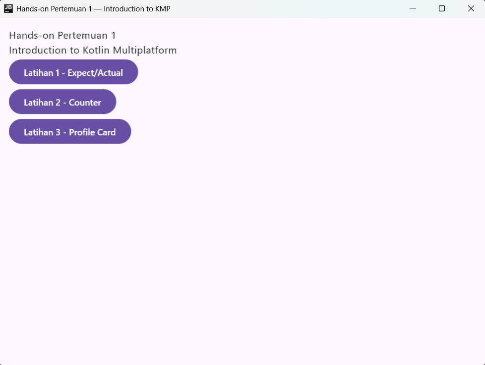
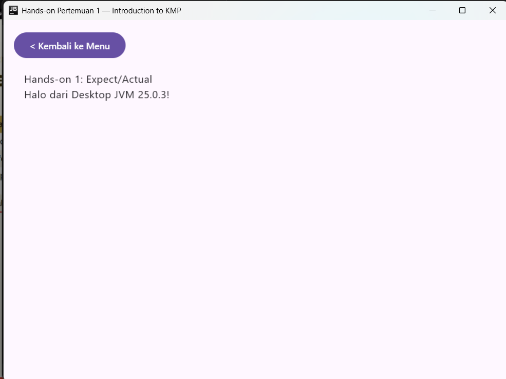
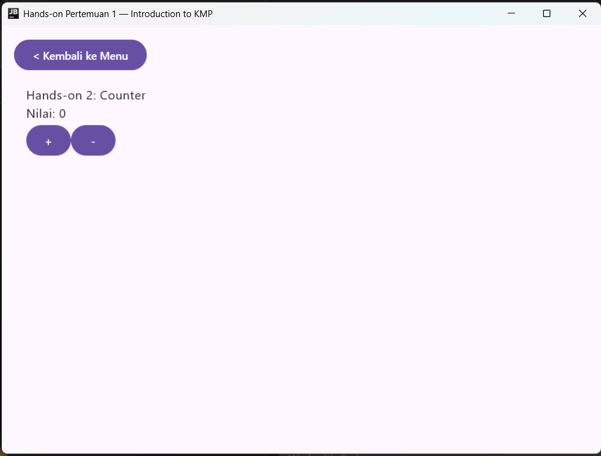
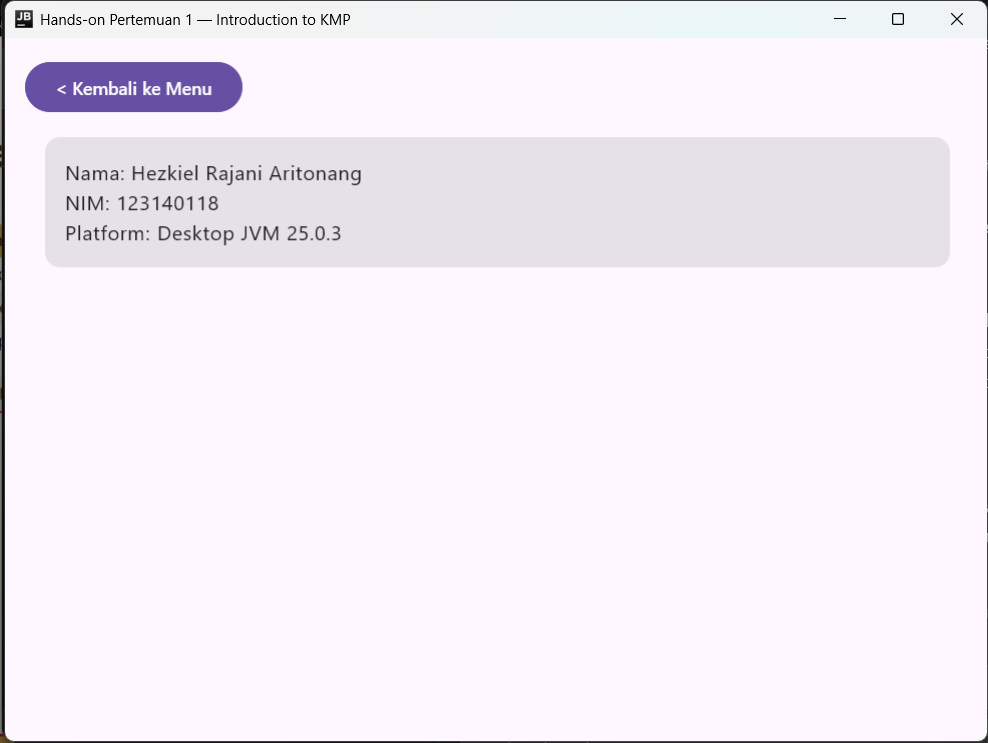
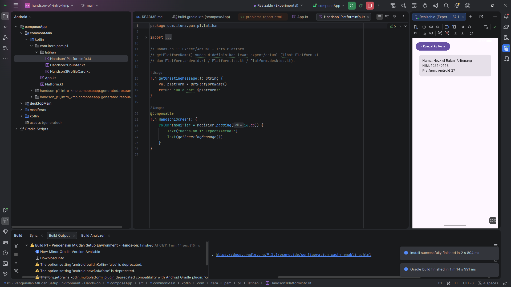
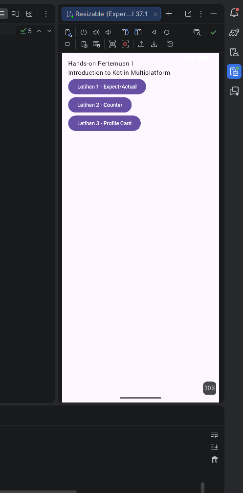

# Hands-on Pertemuan 1 — Pengenalan Kotlin Multiplatform & Setup Environment

Proyek Kotlin Multiplatform (KMP) + Compose Multiplatform untuk 3 latihan praktikum Pertemuan 1 (IF25-22017 — Pengembangan Aplikasi Mobile, ITERA).

Folder ini adalah proyek KMP + Compose Multiplatform dengan satu modul `composeApp`. Pada lingkungan Windows, target yang digunakan adalah `commonMain`, `androidMain`, dan `desktopMain`; source iOS tetap tersedia sebagai referensi, tetapi target iOS tidak diaktifkan karena build iOS memerlukan macOS dan Xcode.

## Capaian Pembelajaran

- Memahami konsep dan arsitektur Kotlin Multiplatform (commonMain/androidMain/iosMain/desktopMain)
- Berhasil setup development environment (Android Studio + KMP Plugin + JDK 17)
- Menerapkan pola `expect`/`actual` untuk kode yang berbeda per platform
- Menggunakan `remember`/`mutableStateOf` untuk state management dasar di Compose
- Menyusun UI dasar dengan `Column`, `Row`, `Card`, dan `Modifier`

## Cara Menjalankan

1. Pastikan Android Studio + **Kotlin Multiplatform plugin** sudah terinstall (lihat slide P1 hal. 20-21 jika belum).
2. Buka folder **"P1 - Pengenalan MK dan Setup Environment - Hands-on"** ini di Android Studio (`File > Open`) sebagai proyek terpisah, lalu tunggu Gradle sync selesai (unduhan pertama kali bisa memakan waktu, perlu koneksi internet stabil).
3. Pilih salah satu run configuration:
   - **Android** — pilih configuration `composeApp`, pilih emulator/device, klik ▶️ (atau `./gradlew :composeApp:installDebug`).
   - **Desktop** — jalankan `./gradlew :composeApp:run` dari terminal (paling cepat untuk coba-coba tanpa emulator).
   - **iOS** *(khusus Mac + Xcode)* — target iOS dinonaktifkan pada proyek Windows ini agar Gradle sync stabil. Untuk mencoba di iOS, aktifkan kembali target iOS pada Mac dan buat proyek Xcode melalui [Kotlin Multiplatform Wizard](https://kmp.jetbrains.com).
4. Di `App.kt`, kamu akan melihat menu untuk berpindah antara Latihan 1-3 (menu ini pakai state sederhana, bukan Navigation Component — itu materi Pertemuan 5).
5. Buka file di `composeApp/src/commonMain/kotlin/.../latihan/`, lengkapi bagian `TODO`, lalu jalankan ulang untuk melihat hasilnya.

## Daftar Latihan

### 1. `Handson1PlatformInfo.kt` — Expect/Actual
Lengkapi `getGreetingMessage()` agar menampilkan pesan sapaan yang menyebutkan nama platform (`getPlatformName()`), yang nilainya berbeda tergantung platform (Android/iOS/Desktop) berkat pola `expect`/`actual`.

- **Konsep:** `expect fun` (commonMain), `actual fun` (androidMain/iosMain/desktopMain).

### 2. `Handson2Counter.kt` — State & Recomposition
Implementasikan counter sederhana dengan tombol `+`/`-` menggunakan `remember { mutableStateOf(0) }`.

- **Konsep:** `remember`, `mutableStateOf`, recomposition, property delegate `by`.

### 3. `Handson3ProfileCard.kt` — Layout Dasar
Susun kartu profil (nama, NIM, platform) menggunakan `Card`, `Column`, `Row`, dan `Modifier`.

- **Konsep:** `Card`, layout composable (`Column`/`Row`), `Modifier` yang chainable.

## Bukti Hasil

### Desktop

| Menu | Platform Info |
| --- | --- |
|  |  |
| Counter | Profile Card |
|  |  |

### Android

| Menu | Profile Card |
| --- | --- |
|  |  |

## Troubleshooting

Diambil dari slide P1 hal. 28, plus tambahan untuk hands-on ini:

| Error | Penyebab | Solusi |
|---|---|---|
| `Gradle sync failed` | SDK atau JDK tidak ditemukan | Pastikan `JAVA_HOME` dan `ANDROID_HOME` sudah di-set |
| `SDK location not found` | `local.properties` tidak ada | Buat file `local.properties` berisi `sdk.dir=path/to/sdk` (Android Studio biasanya membuatnya otomatis saat sync pertama) |
| `Kotlin version mismatch` | Versi Kotlin tidak kompatibel dengan Compose Multiplatform | Update plugin Kotlin & Compose Multiplatform di `gradle/libs.versions.toml` ke pasangan versi yang kompatibel |
| `iOS build failed` | Xcode tidak terinstall/outdated, atau `iosApp/` belum dibuat | Install Xcode terbaru dari App Store (Mac), lalu buat proyek Xcode via kmp.jetbrains.com seperti dijelaskan di atas |

## Catatan: Tugas Praktikum Minggu 1 (terpisah dari hands-on ini)

Ada **Tugas Praktikum Minggu 1** (bobot 4%, deadline sebelum Pertemuan 2) yang meminta memodifikasi Hello World bawaan proyek KMP (bukan proyek hands-on ini): ubah teks menjadi "Halo, [Nama Anda]!", tambahkan NIM, tampilkan nama platform, jalankan di minimal 1 platform, lalu upload ke GitHub repository pribadi. Lihat slide `P1 - Pengenalan MK dan Setup Environment.pdf` halaman 30 untuk detail dan format pengumpulan lengkap.

## Sumber Pustaka

- [Kotlin Multiplatform Documentation](https://www.jetbrains.com/help/kotlin-multiplatform-dev/get-started.html)
- [Compose Multiplatform Documentation](https://www.jetbrains.com/help/kotlin-multiplatform-dev/compose-multiplatform.html)
- [Kotlin Multiplatform Wizard](https://kmp.jetbrains.com)
