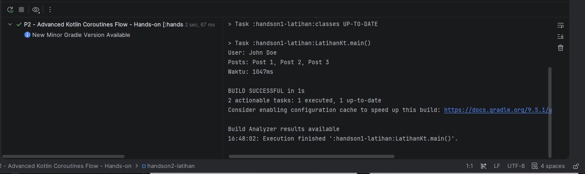
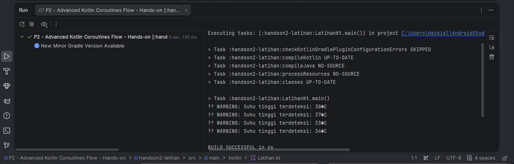
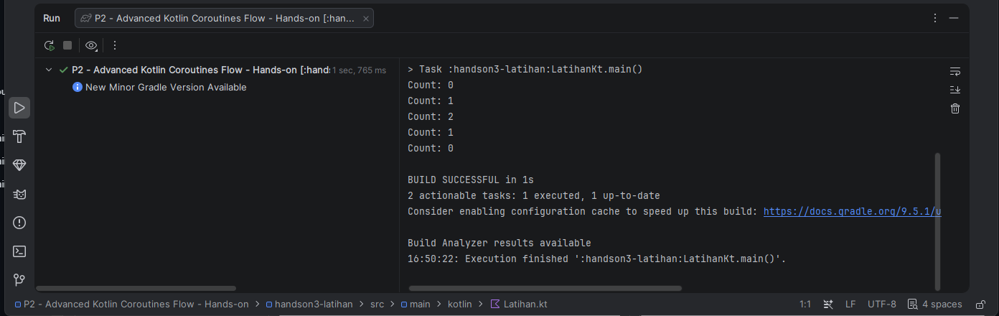

# Hands-on Pertemuan 2 — Advanced Kotlin, Coroutines, dan Flow

Proyek Kotlin/JVM untuk 3 latihan praktikum Pertemuan 2 (IF25-22017 — Pengembangan Aplikasi Mobile, ITERA).

## Capaian Pembelajaran

- Memahami dan menggunakan fitur advanced Kotlin (null safety, extension functions)
- Menjelaskan konsep dan implementasi Kotlin Coroutines
- Mengimplementasikan Kotlin Flow untuk data streaming
- Menerapkan pola asynchronous programming dalam aplikasi mobile

## Cara Menjalankan

1. Buka folder **"Pertemuan 2 - Hands-on"** ini di Android Studio (`File > Open`) sebagai proyek Gradle terpisah.
2. Tunggu proses Gradle sync selesai.
3. Buka file `Latihan.kt` pada modul yang ingin dikerjakan, lengkapi bagian `TODO`.
4. Klik ikon ▶️ di sebelah `fun main()` untuk menjalankan.
5. Lihat output pada panel **Run**. Setiap latihan menampilkan hasilnya sebagai aplikasi Kotlin/JVM console.

Setiap latihan adalah modul Gradle terpisah, jadi latihan yang belum selesai (belum bisa di-compile) **tidak akan mengganggu** latihan atau solusi lain.

## Daftar Latihan

### 1. `handson1-latihan` — Coroutines Dasar
Ambil data dari 2 sumber (`fetchUserProfile`, `fetchUserPosts`) secara **paralel** menggunakan `async`/`await`, lalu gabungkan hasilnya.

- **Target:** waktu eksekusi ~1000ms (bukan ~1800ms jika dijalankan sequential).
- **Konsep:** `async`, `await`, `Deferred`.

### 2. `handson2-latihan` — Flow dengan Operators
Buat Flow yang mensimulasikan sensor suhu (`temperatureSensor`), filter suhu di atas 30°C, transformasikan menjadi pesan warning, lalu tampilkan.

- **Konsep:** `flow {}`, `filter`, `map`, `onEach`, `collect`.

### 3. `handson3-latihan` — StateFlow untuk Counter
Implementasikan `CounterManager` menggunakan `StateFlow` dengan fungsi `increment()`, `decrement()` (minimum 0), dan `reset()`.

- **Konsep:** `MutableStateFlow`, `StateFlow`, `asStateFlow()`.

## Bukti Hasil

P2 merupakan proyek Kotlin/JVM console, sehingga bukti hasil ditampilkan pada panel **Run** Android Studio.

| Coroutines paralel | Flow sensor suhu |
| --- | --- |
|  |  |
| StateFlow counter | |
|  | |

## Troubleshooting

| Error | Penyebab | Solusi |
|---|---|---|
| `Suspend function can only be called from coroutine` | Memanggil suspend function dari fungsi biasa | Panggil dari dalam coroutine scope (`launch`, `runBlocking`, `viewModelScope`) |
| `Flow emission from different coroutine is not allowed` | Emit dari coroutine yang berbeda dalam flow builder | Gunakan `channelFlow` atau `callbackFlow` |
| `Job was cancelled` / `CancellationException` | Parent scope dibatalkan sebelum child selesai | Handle dengan `try-finally` atau `NonCancellable` |

## Tugas Praktikum (terpisah dari hands-on ini)

Ada tugas besar **"News Feed Simulator"** (bobot 4%, deadline Pertemuan 3) yang menggabungkan Flow, StateFlow, dan Coroutines dalam satu aplikasi. Lihat slide `P2 - Advanced Kotlin Coroutines Flow.pdf` halaman 32–33 untuk detail dan rubrik penilaian. Proyek starter untuk tugas ini belum dibuat — beri tahu jika ingin di-scaffold juga.

## Sumber Pustaka

- [Kotlin Coroutines Guide](https://kotlinlang.org/docs/coroutines-guide.html)
- [Kotlin Flow Documentation](https://kotlinlang.org/docs/flow.html)
- [StateFlow and SharedFlow](https://developer.android.com/kotlin/flow/stateflow-and-sharedflow)
